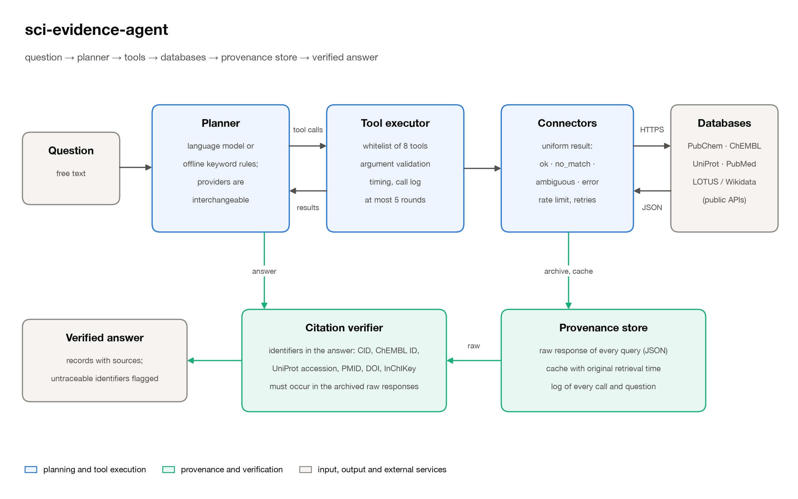
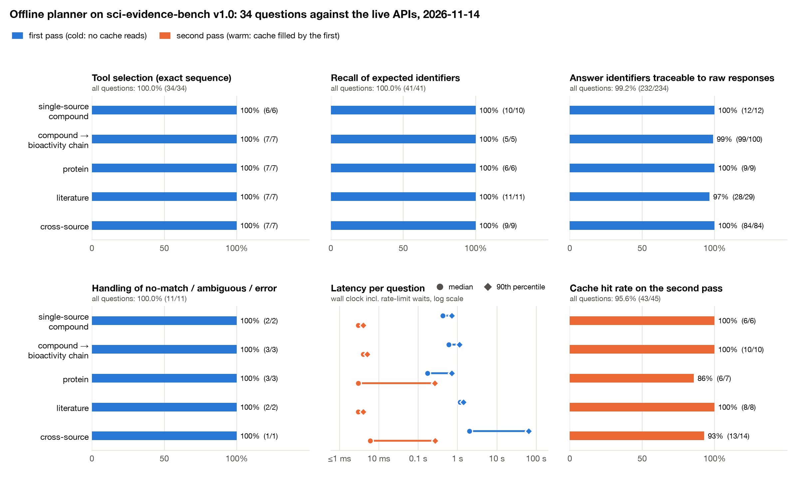

# sci-evidence-agent

A tool-calling agent that answers chemistry and biology questions from public
databases and keeps the evidence. A planner (a language model, or an offline
keyword planner that needs no API key) turns a question into tool calls; the
tools query PubChem, ChEMBL, UniProt, PubMed and LOTUS/Wikidata; every raw
response is archived; and each identifier in the final answer (CID, ChEMBL ID,
UniProt accession, PMID, DOI, InChIKey) is checked against that archive, so an
identifier that no database returned is flagged instead of trusted.



## Install

Python 3.10 or newer.

```bash
git clone https://github.com/OdurShi/sci-evidence-agent.git sci-evidence-agent
cd sci-evidence-agent
python -m venv .venv && source .venv/bin/activate
pip install -e .                  # core: httpx, pydantic, python-dotenv
pip install -e ".[ui]"            # optional: Streamlit interface
pip install -e ".[anthropic]"     # optional: Claude as planner (or ".[openai]")
pip install -e ".[dev,eval]"      # optional: tests, linter, figures
```

With [uv](https://docs.astral.sh/uv/): `uv venv --python 3.12 .venv && uv pip install -e ".[ui,dev,eval]"`.

## Quick start

No key is needed. Without one, the offline planner selects tools by keyword
rules, the queries go to the live databases, and the answer is assembled from
templates and labelled as such.

```console
$ sci-evidence ask "What are the molecular formula, InChIKey and SMILES of aspirin?"
> Note: this text was assembled by the offline keyword planner from templates. It is not model output. Tools were selected by keyword rules; the database queries and the records below are real.

Recognised in the question: `aspirin`

**PubChem** · `search_compound` · ok: PubChem: 1 record
- `CID 2244` · 2-acetyloxybenzoic acid · C9H8O4 · MW 180.16 · InChIKey BSYNRYMUTXBXSQ-UHFFFAOYSA-N · SMILES `CC(=O)OC1=CC=CC=C1C(=O)O` · [source](https://pubchem.ncbi.nlm.nih.gov/compound/2244)
- Check in the database: https://pubchem.ncbi.nlm.nih.gov/compound/2244

-- Offline planner (not a model) · keyword-planner · 2 round(s)
-- search_compound({"query": "aspirin", "limit": 5}) -> ok, 1 record(s), 767 ms
-- identifiers in the answer: 2 (traceable 2, echoed 0, untraceable 0)
```

Other entry points:

```bash
sci-evidence ask "List bioactivity assay records for aspirin from ChEMBL." --json
sci-evidence smoke                     # are the five services reachable? (live)
sci-evidence ui                        # Streamlit interface on http://localhost:8501
pytest                                 # offline test suite
pytest -m "live and not lotus"         # the same connectors against the live APIs
```

From Python:

```python
from sci_evidence_agent.agent import ask
from sci_evidence_agent.citations import verify_run

run = ask("Find the UniProt entry for human EGFR.", provider="offline")
print(run.answer)
print(run.tool_rounds())  # [['search_protein']]
print(verify_run(run).counts())  # identifiers: traceable / echoed / untraceable
```

The connectors work without the agent: `from sci_evidence_agent.connectors import search_compound`.

## Sources and tools

| Tool | Source | Returns |
|---|---|---|
| `search_compound(query, limit)` | PubChem (PUG REST) | CID, IUPAC name, formula, SMILES, InChIKey, molecular weight; `query` is a name or a CID |
| `search_chembl_molecule(query, limit)` | ChEMBL | ChEMBL ID, preferred name, formula, SMILES, InChIKey; `query` is a name or a ChEMBL ID |
| `get_bioactivities(chembl_id, limit)` | ChEMBL | target ID, assay ID, assay type, measurement type, relation, value, units |
| `search_protein(query, organism_id, reviewed_only, limit)` | UniProtKB | accession, protein name, gene names, organism, length; Swiss-Prot only by default |
| `search_literature(term, limit, sort)` | PubMed (E-utilities) | PMID, title, authors, journal, date, DOI; PubMed query syntax |
| `get_article(pmid)` | PubMed (E-utilities) | the same fields for one PMID |
| `search_by_taxon(taxon, limit)` | LOTUS via Wikidata | compounds reported in a taxon, each with its literature references (DOI, PMID) |
| `search_occurrences(inchikey, limit)` | LOTUS via Wikidata | taxa in which a compound was reported |

Every tool returns the same `ToolResult` with one of four states, which are
never merged:

| State | Meaning |
|---|---|
| `ok` | records were found |
| `no_match` | the query was valid and nothing matched |
| `ambiguous` | several candidates; they are listed and none is picked |
| `error` | the request failed (timeout, rate limit, HTTP error); never cached |

A result also carries the arguments used, a source URL, the original retrieval
time, whether it came from the cache, whether it was truncated and the
upstream total, warnings, and the path of the archived raw response.

## Provenance and citation verification

**Provenance store.** Each successful query writes its raw upstream response
to `data/raw/<source>_<key>.json`, wrapped in an envelope with the tool name,
arguments, request URLs and time. `<key>` is a hash of source, tool and
arguments, and the same key addresses the cache entry in `data/app.db`
(SQLite). Cached results keep their original retrieval time and expire after
24 hours. The database also logs every tool call (arguments, duration, state)
and every question. API keys and e-mail addresses are stripped from all stored
URLs.

**Politeness.** One HTTP layer serves all connectors: a minimum interval per
service, at most three attempts with exponential backoff, a short
`Retry-After` honoured, and a long one (over 60 s) reported at once instead of
retried. The Wikidata Query Service is spaced at 61 s by default.

**Citation verifier.** `sci_evidence_agent.citations` extracts identifiers
from an answer and looks for each one in the archived raw responses of the
tool calls behind that answer:

- shape-defined identifiers (ChEMBL ID, UniProt accession, DOI, InChIKey) are
  matched in any raw response of the run; DOIs are compared case-insensitively
  and molecular formulas such as `C9H8O4` are not mistaken for accessions;
- CIDs and PMIDs are bare integers, so they are only read next to a label, in
  a PubChem or PubMed URL, or in a table column headed CID or PMID, and they
  only count as backed when the integer is a value in a PubChem response (CID)
  or in a PubMed or LOTUS response (PMID).

Each identifier is `traceable` (found in a raw response), `echoed` (not found,
but supplied by the user in the question) or `untraceable`. An untraceable
identifier is reported for a manual check by `sci-evidence ask`, by
`sci-evidence verify <pass.jsonl>` and in the UI.

## Evaluation

The benchmark `benchmark/questions.json` has 34 questions in five categories
(single-source compound, compound → bioactivity chain, protein, literature,
cross-source), each with the expected tool calls per round, the expected state
of every call (23 questions expect only `ok`; 11 exercise `no_match`,
`ambiguous` or `error`), and key identifiers that were checked against the
live databases on 2026-11-14. No model is involved: the offline planner is run
end to end against the live APIs, twice. The first pass never reads the cache;
the second reuses what the first stored.



First pass, from `results/eval-2026-11-14/summary.md` (latency in seconds,
wall clock including rate-limit waits):

| Category | Questions | Tool selection (exact) | Expected identifiers in answer | Answer identifiers traceable | Non-ok states handled | Latency median / p90 |
|---|---|---|---|---|---|---|
| single-source compound | 6 | 6/6 | 10/10 | 12/12 | 2/2 | 0.42 / 0.72 |
| compound → bioactivity chain | 7 | 7/7 | 5/5 | 99/100 | 3/3 | 0.59 / 1.11 |
| protein | 7 | 7/7 | 6/6 | 9/9 | 3/3 | 0.17 / 0.71 |
| literature | 7 | 7/7 | 11/11 | 28/29 | 2/2 | 1.16 / 1.42 |
| cross-source | 7 | 7/7 | 9/9 | 84/84 | 1/1 | 2.02 / 64.12 |
| all | 34 | 34/34 | 41/41 | 232/234 (99.2%) | 11/11 | 0.69 / 1.92 |

- **Traceability.** 232 of the 234 identifiers in the answers occur in archived
  raw responses. The other two are `echoed`: `CHEMBL99999999` and
  `PMID 999999999`, which the questions themselves supply and which the
  databases answer with `no_match`. None is `untraceable`.
- **Negative control.** Six invented identifiers, one of each kind, were
  appended to every answer; the verifier flagged all six in 34 of 34 answers.
- **Second pass.** 43 of 45 tool calls (95.6%) were served from the cache; the
  two others are the two UniProt requests that fail with HTTP 400, and errors
  are never cached. Median latency 0.003 s, 90th percentile 0.006 s. All 34
  answers are identical to the first pass. HTTP requests: 53 in the first
  pass, 2 in the second.
- **Latency.** The 64 s in the cross-source row is the 65 s spacing used
  between Wikidata Query Service requests in this run.
- **Determinism.** Replaying the recorded HTTP exchanges offline reproduces
  every metric except latency and all 68 answers
  (`results/eval-2026-11-14/replay_check.json`).

These numbers measure the pipeline (tool execution, chaining, state handling,
archiving, verification), not language understanding: the planner is a set of
keyword rules written alongside the benchmark. Two further measurements put
its tool selection in context, both without network access:

| Planning only | Tool rounds correct | Tool rounds and arguments correct | File |
|---|---|---|---|
| 20 held-out paraphrases, this planner | 18/20 | 10/20 | `results/eval-2026-11-14/summary.json`, key `heldout_planning` |
| 34 benchmark questions, prototype planner | 22/34 | not scored; the queried entity is a generic word ("What", "record", ...) in 28/34 | `results/eval-2026-11-14/prototype_planner_baseline.json` |

On freely phrased questions the rules pick the right tools but often the wrong
query string ("string" instead of "ibuprofen"), which is the reason to use a
model as planner for anything beyond regression testing.

Reproduce:

```bash
sci-evidence eval --benchmark benchmark/questions.json \
    --heldout benchmark/heldout_paraphrases.json \
    --out results/my-run --record                    # live, about 2.5 minutes
sci-evidence eval --out results/my-replay \
    --replay results/my-run/http_cassette.json.gz    # offline, a few seconds
sci-evidence verify results/my-run/pass1_cold.jsonl  # re-check identifiers
python scripts/make_figures.py results/my-run        # redraw the figures
```

Metric definitions are in `src/sci_evidence_agent/evaluation.py`; the files of
a run are described in `results/README.md`.

## Configuration

Everything is set through environment variables; `.env.example` lists them
with empty values. A `.env` file in the working directory is read by the
command line and the UI.

| Variable | Purpose |
|---|---|
| `LLM_PROVIDER` | `anthropic`, `openai` or `offline`. Unset: `anthropic` if its key is present, otherwise `offline` |
| `ANTHROPIC_API_KEY`, `ANTHROPIC_MODEL` | Anthropic provider; model defaults to `claude-opus-5-5` |
| `LLM_MODEL`, `LLM_BASE_URL`, `LLM_API_KEY` (or `OPENAI_API_KEY`) | any OpenAI-compatible endpoint, including local servers such as vLLM or Ollama |
| `NCBI_API_KEY`, `NCBI_EMAIL` | optional identification for PubMed; a key raises the limit from 3 to 10 requests per second |
| `SCI_EVIDENCE_DATA_DIR` | cache, log and raw archive; default `./data` |
| `SCI_EVIDENCE_CACHE_TTL_HOURS` | cache lifetime; default 24 |
| `SCI_EVIDENCE_USER_AGENT` | User-Agent header; add a contact address for large jobs |
| `SCI_EVIDENCE_WDQS_INTERVAL` | seconds between Wikidata Query Service requests; default 61 |

Switching provider changes nothing outside `src/sci_evidence_agent/providers/`:
the agent loop only sees neutral `ToolSpec`, `ToolCall` and `LLMResponse`
objects.

```bash
LLM_PROVIDER=openai LLM_MODEL=deepseek-chat LLM_BASE_URL=https://api.deepseek.com/v1 LLM_API_KEY=...
LLM_PROVIDER=openai LLM_MODEL=qwen2.5:32b LLM_BASE_URL=http://localhost:11434/v1     # Ollama
```

## Repository structure

```
src/sci_evidence_agent/
  agent.py          agent loop: planner turns, tool rounds, final answer
  planning.py       offline planner: question -> tool calls (pure, no I/O)
  execution.py      tool executor: whitelist, argument validation, timing
  reporting.py      template report of the offline planner
  tools.py          tool definitions (JSON Schema), registry, defaults
  connectors/       pubchem, chembl, uniprot, pubmed, lotus; base.py (cache, archive, log)
  http.py           HTTP layer: rate limiter, retries, backoff, secret redaction
  storage.py        provenance store: SQLite cache and logs, raw archive
  identifiers.py    identifier shapes shared by planner and verifier
  citations.py      citation verifier
  evaluation.py     benchmark harness and metrics
  cassette.py       record and replay of HTTP exchanges
  providers/        anthropic, OpenAI-compatible, offline; neutral interface in base.py
  smoke.py, cli.py  connectivity check; command line
  ui/app.py         Streamlit interface
benchmark/          questions.json (34 questions), heldout_paraphrases.json (20)
tests/              offline tests; fixtures/ holds recorded API responses
scripts/            record_fixtures.py, make_figures.py, check_replay.py
results/            evaluation run of 2026-11-14
figures/            architecture.png, eval_per_category.png, teaser_1600x1000.png
docs/notes.md       scope of the evaluation, changes from the prototype, known limits
```

## Licence

Code: MIT, Copyright (c) 2026 The authors; see `LICENSE`. Data retrieved from
the databases, including the recorded responses under `tests/fixtures/` and
the outputs under `results/`, stay under the terms of their sources (below).

## Acknowledgements

This software queries the following public resources. Please cite them, and
follow their terms, when you use what it retrieves.

| Resource | Provider | Terms |
|---|---|---|
| [PubChem](https://pubchem.ncbi.nlm.nih.gov/) | National Center for Biotechnology Information, U.S. National Library of Medicine | [NCBI policies](https://www.ncbi.nlm.nih.gov/home/about/policies/); [citation guidelines](https://pubchem.ncbi.nlm.nih.gov/docs/citation-guidelines); at most 5 requests per second |
| [ChEMBL](https://www.ebi.ac.uk/chembl/) | EMBL-EBI | data under [CC BY-SA 3.0](https://creativecommons.org/licenses/by-sa/3.0/) (share-alike); see the [ChEMBL documentation](https://chembl.gitbook.io/chembl-interface-documentation/about) |
| [UniProt](https://www.uniprot.org/) | UniProt Consortium | [CC BY 4.0](https://www.uniprot.org/help/license); [how to cite](https://www.uniprot.org/help/publications) |
| [PubMed](https://pubmed.ncbi.nlm.nih.gov/) | U.S. National Library of Medicine | [NLM terms](https://www.nlm.nih.gov/databases/download/terms_and_conditions.html); [E-utilities usage policy](https://www.ncbi.nlm.nih.gov/books/NBK25497/) |
| [LOTUS](https://lotus.naturalproducts.net/) in [Wikidata](https://www.wikidata.org/) | LOTUS initiative; Wikimedia Foundation | CC0 1.0 ([Wikidata licensing](https://www.wikidata.org/wiki/Wikidata:Licensing)); [User-Agent policy](https://foundation.wikimedia.org/wiki/Policy:Wikimedia_Foundation_User-Agent_Policy). LOTUS: Rutz et al., eLife 2022, doi:[10.7554/eLife.70780](https://doi.org/10.7554/eLife.70780) |

ChEMBL's share-alike licence matters if you publish a dataset built with this
tool: a dataset that contains ChEMBL records must be released under a
compatible licence.
